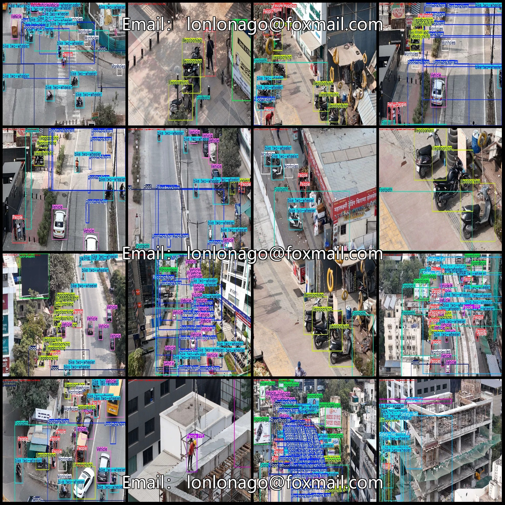
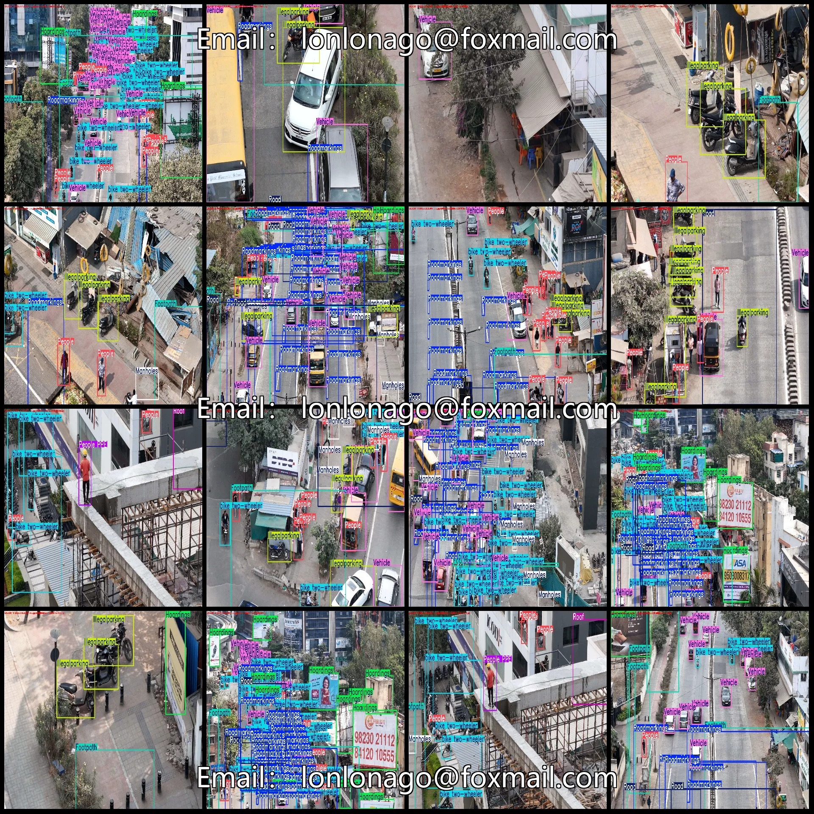
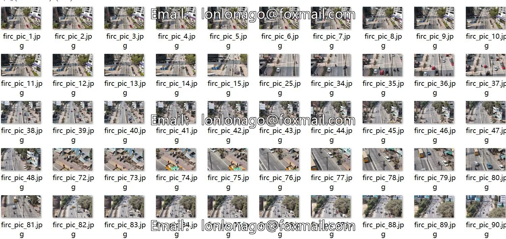
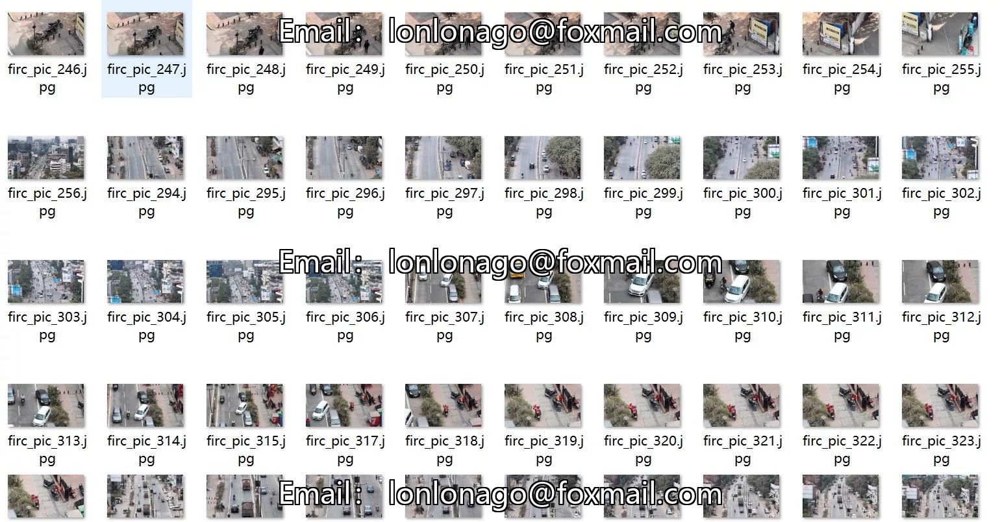
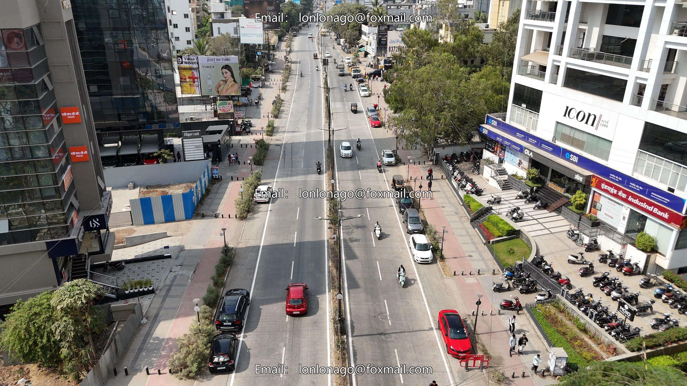
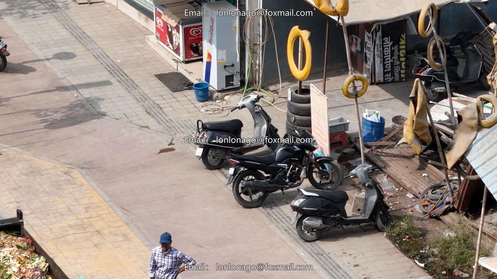
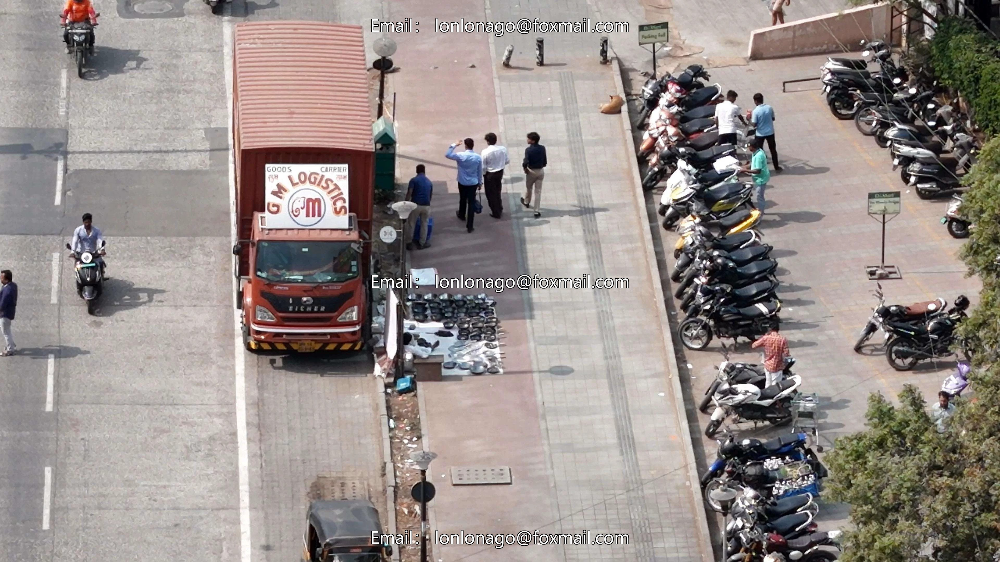

# UAV Perspective Smart City Management and Governance Personnel Vehicles, Utility Boxes, and Illegal Parking Detection Data Set

## Body

Drone-Viewed Smart City Management and Governance Personnel Vehicles, Manhole Covers, and Advertising Illegal Parking Detection Dataset VOC+YOLO Format: 540 Images in 17 Categories
Warm Reminder: Due to the dataset's replicability, please confirm compliance with requirements before purchasing.
Dataset Format: Pascal VOC format + YOLO format (excluding split paths in txt files, only containing jpg images along with corresponding VOC format xml files and yolo format txt files)
Number of Images (Total jpg files): 540
Number of Annotations (Total xml files): 540
Number of Annotations (Total txt files): 540
Number of Annotation Categories: 17

Label category names (Note that the order of yolo-style categories does not correspond to this, but is based on the labels folder's classes.txt): ["Desired Path", "Footpath", "Hoardings", "Illegal parking", "JCB", "Manholes", "People", "People PPE", "Road", "Roadmarkings", "Roadside hazards", "Roof", "Safety-Net", "Tractor", "Vehicle", "bike two-wheeler", "fi"]

re-smoke

Number of boxes and number of images per category
Desired Path (desired path) Frames = 1, Images = 1
Footpath (footpath) Frames = 755, Images = 437
Hoardings (hoardings) Frames = 1110, Images = 271
Illegal parking (illegal parking) Frames = 1202, Images = 281
JCB (excavator/engineering machinery) Frames = 4, Images = 4
Manholes (manholes) Frames = 1102, Images = 228

People (people) Frames = 2884, occupied images = 411
People PPE (personal protective equipment for people) Frames = 48, occupied images = 44
Road (road) Frames = 669, occupied images = 282
Road markings (road markings) Frames = 5443, occupied images = 328
Roadside vendors (roadside vendors) Frames = 18, occupied images = 18
Roof (roof) Frames = 46, occupied images = 46
Safety-Net (safety net) Frames = 201, occupied images = 70

Tractor (tractor) Frames = 3, Image Count = 2
Vehicle (vehicle) Frames = 5660, Image Count = 406
Two-Wheeler (bike/two-wheeler) Frames = 4470, Image Count = 399
Fire-Smoke (fire-smoke) Frames = 2, Image Count = 2
Total Frames: 23618
Image Resolution: 3840x2160
Labeling Tool: labelImg
Labeling Rules: Draw a rectangle around the category.
Important Note: The dataset does not have separate training, validation, and test sets; you will need to manually divide them.

Special : This dataset does not guarantee the accuracy of the trained models or weight files.

## Images

## Payment

Here is a pay link on Stripe ( https://buy.stripe.com/3cs8yP7sY87d0vu9AB ). Please contact me lonlonago@foxmail.com after funding $89, and I will send you a complete data files , thank you!

